<p align="center"></p>

<p align="center">
  <b>Version control for LabVIEW projects — with block diagram diffs you can read without opening LabVIEW.</b>
</p>

<p align="center">
  <a href="LICENSE"></a>
  
  
  
  <a href="https://claude.ai"></a>
</p>

<p align="center">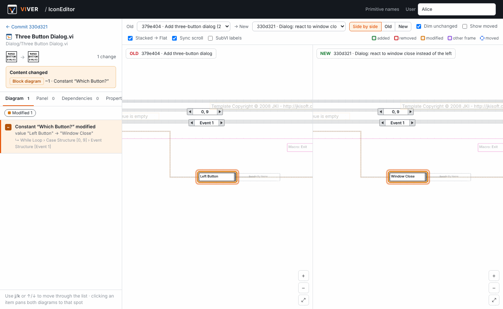</p>

---

## Contents

- [Why VIVER?](#why-viver)
- [Feature tour](#feature-tour)
- [How it works](#how-it-works)
- [Installation](#installation)
- [Quick start](#quick-start)
- [What counts as a change?](#what-counts-as-a-change)
- [Generating a CHANGELOG](#generating-a-changelog)
- [Safety and backups](#safety-and-backups)
- [Primitive names](#primitive-names)
- [Command line and LabVIEW integration](#command-line-and-labview-integration)
- [Configuration](#configuration)
- [FAQ](#faq)
- [Known limitations](#known-limitations)
- [Project structure](#project-structure)
- [License, trademarks and credits](#license-trademarks-and-credits)

---

## Why VIVER?

LabVIEW code lives in binary `.vi` files. General-purpose version control systems store them fine, but they cannot tell you **what changed**: Git only says *"binary file changed"*, and LabVIEW re-saves files when you merely open them, so the list of "changed" files is full of noise. Comparing two versions graphically normally requires LabVIEW and its compare tool on the machine.

**VIVER** is a small, self-hosted web application that fills this gap:

| | |
|---|---|
| 📦 **Every commit is a full backup** | Each commit is a complete snapshot of the project, stored content-addressed — unchanged files are never stored twice. |
| 🔍 **Visual diffs without LabVIEW** | VIs are parsed with [pylabview](https://github.com/mefistotelis/pylabview) and the old and new block diagrams are drawn side by side, with every added, removed and modified item highlighted. |
| 🧹 **Noise filtering** | VIVER tells real logic changes apart from layout tweaks and from "LabVIEW just re-saved it" — and hides the noise. |
| 📄 **CHANGELOG with pictures** | One click turns a version range into a `CHANGELOG.md` with a summary table and an SVG of the previous and new diagram of every changed VI. |
| 🛡 **Safe by design** | Project files are read through verified snapshot copies, every backup is checksummed, and you can forbid VIVER from ever writing to your project folder. |
| 🔌 **Offline and local** | Runs on your own computer (or a server in your network). No cloud, no account, no telemetry. |

It feels like a small, private GitHub for a LabVIEW project: repositories, commits, history, branches, tags, compare views — plus a block diagram viewer.

---

## Feature tour

### Changes & Commit

VIVER watches the project folder you link to a repository. The **Changes & Commit** tab lists every changed file; for each VI it shows *what kind* of change it is — before you commit and without opening LabVIEW. Write a message, click **Commit and back up**, and the full project state is stored.

<p align="center">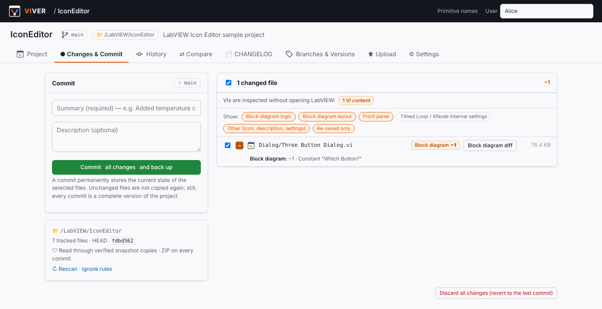</p>

The **Show:** chips filter by category (block diagram logic, layout, front panel, Timed Loop / XNode internal settings, other, re-saved only). Hidden VIs can be left out of the commit with one click.

### Block diagram diff

Click **Block diagram diff** next to any VI to open the side-by-side view:

- The old and new diagrams are drawn with structures, subVIs, primitives, constants (with their values), terminals, tunnels, shift registers, comments and wires in LabVIEW colors.
- 🟩 added, 🟥 removed, 🟧 modified, 🟪 moved into another structure/frame, 🟦 moved (optional). Unchanged items are dimmed.
- Clicking an entry in the change list pans **both** diagrams to that spot and opens the right case/event frame. `j` / `k` step through the list.
- Pan, zoom and frame selection are synchronized between the two sides.
- Tabs for front panel controls, dependencies (subVIs, typedefs, libraries) and VI properties.

A constant whose value changed is reported with the old and new value — here inside a **Stacked Sequence**, which VIVER unfolds like a Flat Sequence so every frame is visible at once:

<p align="center">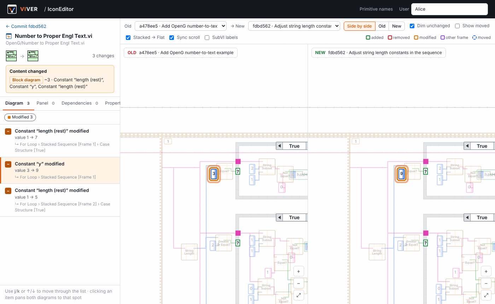</p>

### History, commits and compare

Every commit records its author, message and the full file tree. The history is grouped by day; tags such as `v1.0` mark releases.

<p align="center">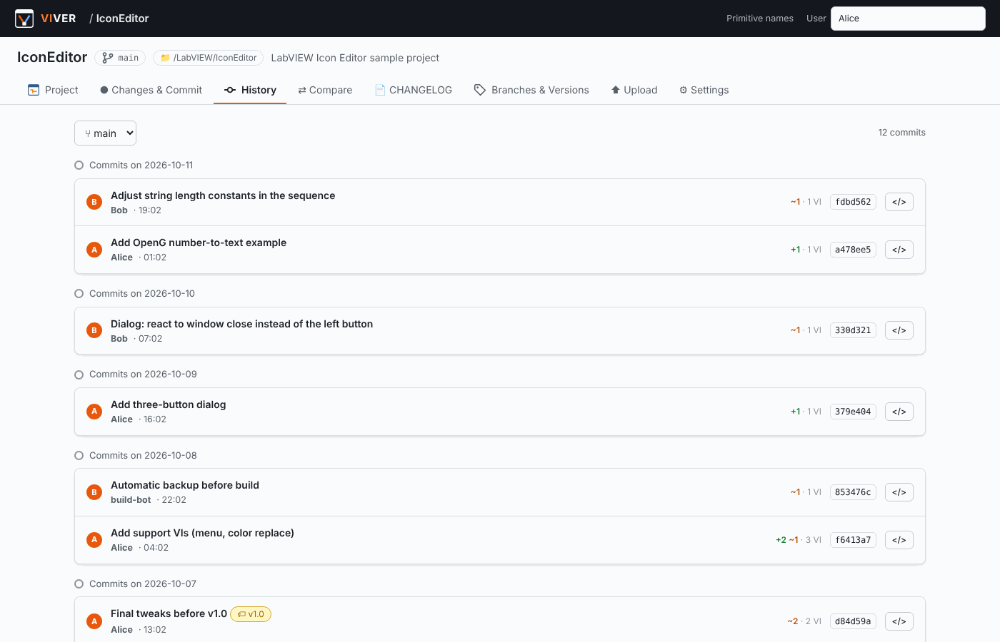</p>

A commit page shows the changed files with their VI summaries and offers actions: browse the files of that version, download it as a ZIP, restore it (into the project folder or **into another folder**), tag it, create a branch from it, or generate a CHANGELOG.

<p align="center">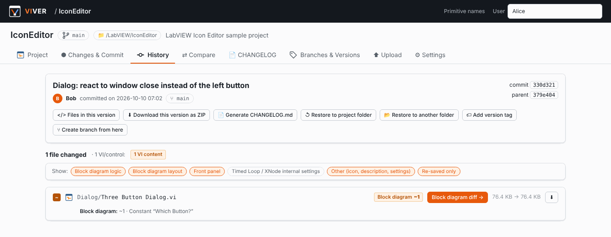</p>

**Compare** works between any two commits, branches or tags:

<p align="center">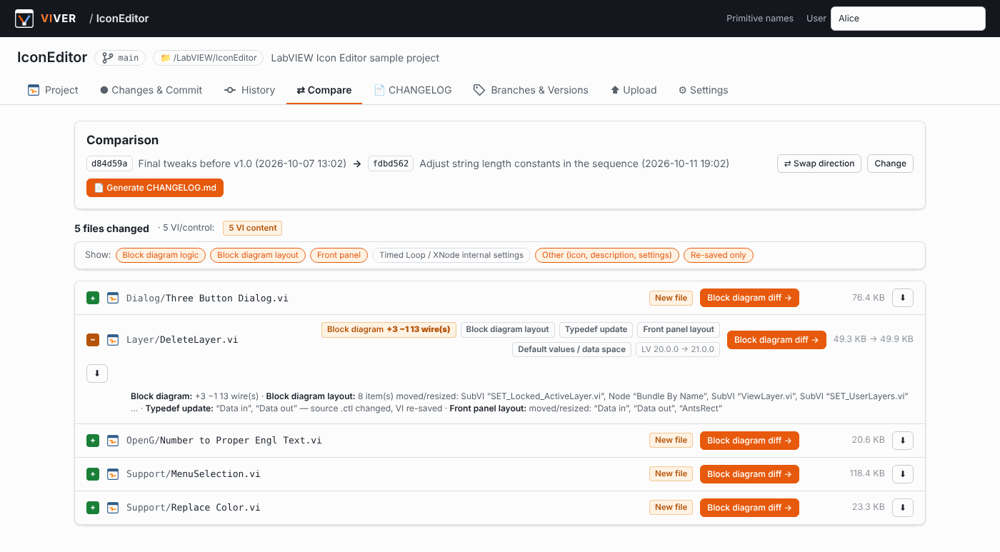</p>

### CHANGELOG generation

Pick a range, choose which categories to include, and VIVER writes a Markdown changelog with images. A preview is shown in the browser; download it as a ZIP or save it into the project folder.

<p align="center">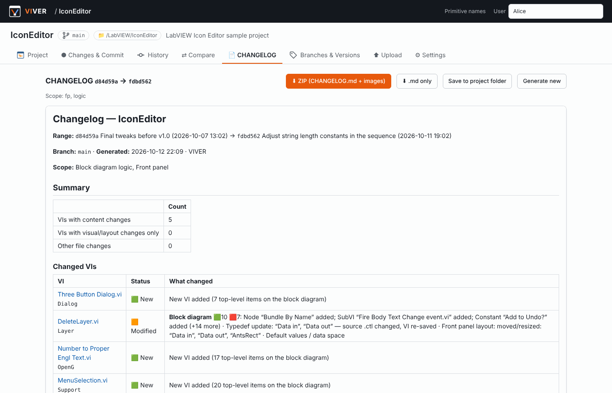</p>

Every changed VI gets **one SVG that contains both the previous and the new block diagram**, with numbered badges that match the change list. This is a real image generated by VIVER (click to open it at full size — it is vector graphics and stays sharp when zoomed):

<p align="center"><a href="docs/example/changelog-images/Dialog__Three_Button_Dialog_v1.svg"></a></p>

👉 See the complete generated example: **[docs/example/CHANGELOG.md](docs/example/CHANGELOG.md)**

### Settings: safety and backups

<p align="center">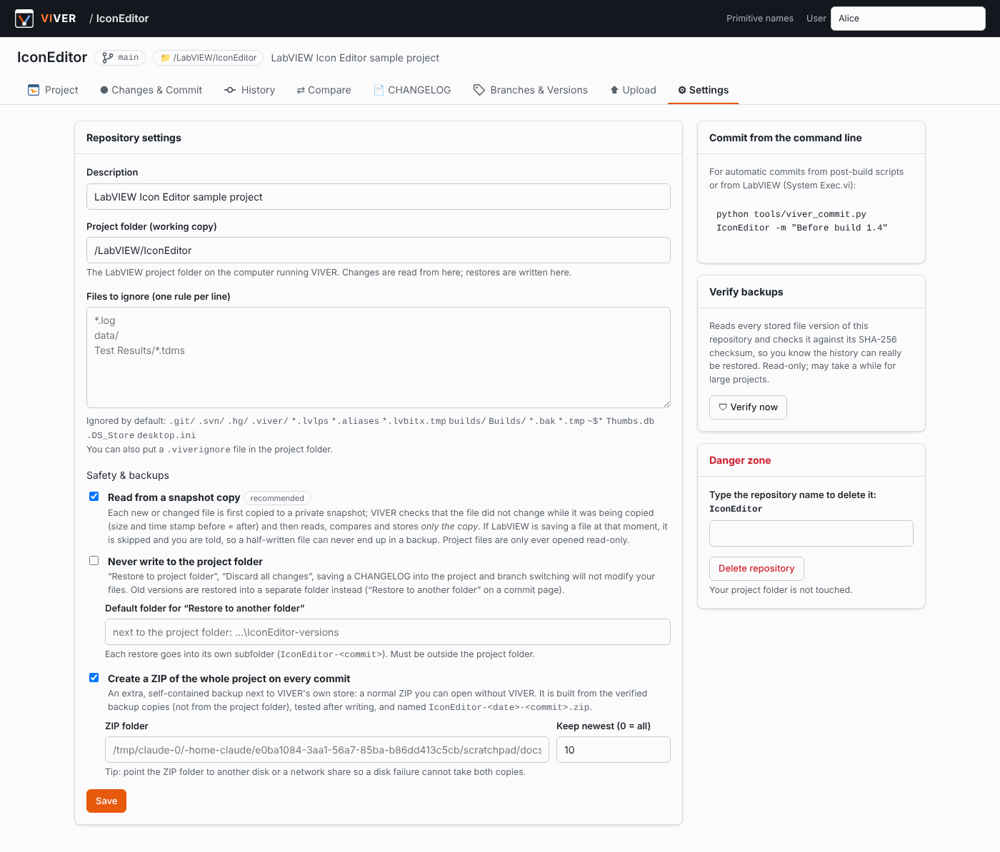</p>

---

## How it works

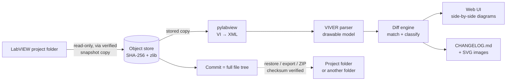

1. **Snapshot and store.** When you open the changes page or commit, every new or modified file is copied into a private snapshot, checked for consistency, and stored in `data/objects/` under its SHA-256 hash (zlib-compressed). A commit is just the list *path → hash* of all files, so every commit is a complete backup while identical contents are stored only once.
2. **Parse.** A VI is an RSRC container with many blocks (block diagram heap `BDHb`, front panel heap `FPHb`, type tables `VCTP`/`DTHP`, connector pane, links, icon …). pylabview decodes the container and the heaps into XML. VIVER then resolves coordinates of nested structures, connects wires to terminals, decodes constant values, case/event frame names, variable names and data types, and builds a drawable model.
3. **Diff.** Nodes of the two versions are matched (by object id and signature, then by position), wires are compared by their end points, and a global shift (e.g. after *Clean Up Diagram*) is detected. Each file then gets a **verdict** — see [What counts as a change?](#what-counts-as-a-change).
4. **Show.** The web UI draws both diagrams as SVG in the browser; the CHANGELOG generator draws them on the server into one SVG per VI.

Parse and diff results are cached by content hash, so a VI pair is only analysed once.

---

## Installation

**Requirements:** Python 3.9 or newer (on Windows, the python.org installer is recommended). LabVIEW is **not** required — if it is installed, VIVER reads the primitive names from it (see [Primitive names](#primitive-names)).

**Windows** — download or clone the repository and double-click **`start.bat`**. On the first run it creates a virtual environment and installs the dependencies; then `http://127.0.0.1:5000` opens in your browser.

**Linux / macOS**

```bash
./start.sh
```

**Manual**

```bash
python -m venv .venv
.venv\Scripts\activate            # Linux/macOS: source .venv/bin/activate
pip install -r requirements.txt
python app.py
```

An internet connection is needed only for that first `pip install` (Flask, Pillow, waitress). For an offline machine, run `pip download -r requirements.txt -d packages` on a connected computer and install with `pip install --no-index --find-links packages -r requirements.txt`.

---

## Quick start

<p align="center">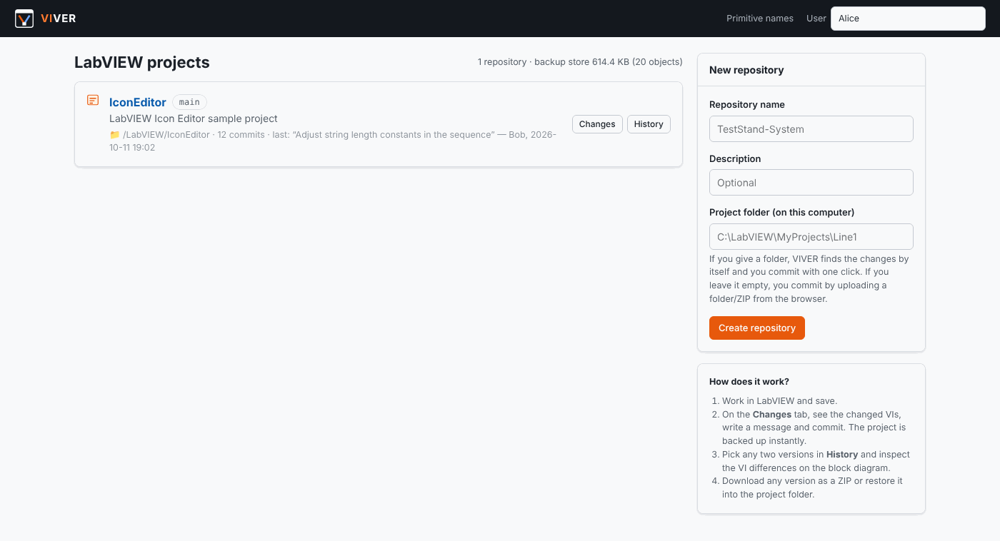</p>

1. **Create a repository.** On the home page, enter a name and the path of your LabVIEW project folder (e.g. `C:\LabVIEW\Line1`) and click **Create repository**.
2. **Work in LabVIEW as usual** and save.
3. **Commit.** Open **Changes & Commit**, check the summaries, write a message, click **Commit and back up**. The first commit stores the whole project.
4. **Inspect.** Use **History** → a commit → **Block diagram diff**, or **Compare** for any two versions.
5. **Release.** Tag a commit (e.g. `v1.1`) and generate a **CHANGELOG** from the previous tag.

No project folder on the VIVER machine? Use **Upload** to commit a folder (drag and drop) or a ZIP from the browser.

---

## What counts as a change?

LabVIEW rewrites a VI when you merely open and save it, when a subVI or typedef it uses changes, or when it recompiles. VIVER compares every changed VI section by section and gives it one of three verdicts:

| Verdict | Meaning | Shown as |
|---|---|---|
| **Content changed** | Nodes, wires or constant values on the block diagram, front panel controls, connector pane, dependencies or important VI properties changed | Orange badge naming the change, e.g. *Block diagram ~1 · Constant "Which Button?"* |
| **Visual / layout** | Only positions, sizes, wire routing, front panel appearance, icon, description, a typedef update (the source `.ctl` changed) or default values | Grey badge |
| **Re-saved only** | None of the above — only the revision counter, compiled code, internal numbers, the frame that was visible when saving, or tiny font-metric differences | Collapsed into a "N VIs re-saved only" group (still included in the commit) |

Each change also belongs to a **category** used by the filters and by the CHANGELOG scope:

| Category | Contains |
|---|---|
| Block diagram logic | nodes, wires, constants, variables, connector pane, dependencies, important VI properties |
| Block diagram layout | placement, wire routing, comments |
| Front panel | controls and indicators, appearance, typedef updates, default values |
| Timed Loop / XNode internal settings | settings LabVIEW regenerates by itself (common on FPGA) — **off by default** |
| Other | icon, description, other VI settings |
| Re-saved only | see above |

> **Safety principle:** VIVER never hides a difference it is not sure about. Anything it cannot explain is shown (at least as "visual/layout"), and unreadable VIs are always reported as *unreadable*.

---

## Generating a CHANGELOG

Open the **CHANGELOG** tab (or click **Generate CHANGELOG.md** on a commit or compare page):

<p align="center">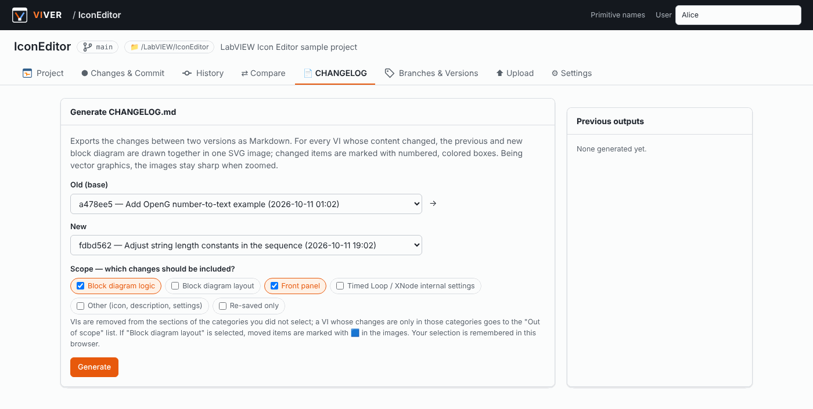</p>

The generated `CHANGELOG.md` contains:

1. **Summary** — counts, then a **Changed VIs** table with one line per VI (e.g. `Constant "y" modified (value 3 → 9)`); VI names link to their sections.
2. **Commits** in the range with author and message.
3. **One section per changed VI** — the numbered change list and one SVG with the previous and new block diagram. If changes are in different case frames, one SVG per frame is created. Frame-only moves (🟪) are listed last as the least important.
4. Collapsed lists of VIs **out of scope** and **re-saved only**, and **other files** (with a text diff for text files).

Output: `CHANGELOG.md` + `changelog-images/`. Download as a ZIP, or save into the project folder and commit it. GitHub, GitLab and most Markdown viewers display the SVGs directly.

From the command line:

```bash
python tools/viver_commit.py Line1 --changelog v1.0..main -o CHANGELOG.zip --scope logic,fp
```

---

## Safety and backups

You are trusting VIVER with your source code, so it is deliberately conservative. Per repository, in **Settings → Safety & backups**:

| Option | Default | What it does |
|---|---|---|
| **Read from a snapshot copy** | on | Every new or changed file is first copied to a private snapshot. The copy is accepted only if the file had not been modified for 2 seconds and did not change while being copied; then VIVER reads, compares and stores **only the copy**. A file LabVIEW is saving at that moment is skipped with a warning and the commit is refused — a half-written file never ends up in a backup. |
| **Never write to the project folder** | off | Restore, "Discard all changes", saving a CHANGELOG into the project and branch switching will not modify your files. Old versions are restored into a separate folder with **Restore to another folder**. |
| **ZIP of the whole project on every commit** | off | An extra, self-contained ZIP (openable without VIVER) per commit, built from the verified backups, tested after writing, named `<repo>-<date>-<commit>.zip`. Choose the folder (e.g. another disk or a network share) and how many to keep. |

Always on:

- Project files are only ever **opened read-only**; VI parsing works on the stored copies, never on the project folder.
- Every stored file version is identified by its **SHA-256**. Restores, exports and ZIPs verify each file before writing; files written to disk are read back and checked, written to a temporary name and only then moved into place.
- Before an in-place restore, the current state of the project folder is saved as a ZIP in `data/restore-backups/`.
- **Verify backups** (Settings) re-reads the complete history of a repository and checks every stored file against its checksum.

---

## Primitive names

VI files store LabVIEW's built-in functions (Add, Equal?, Index Array …) only by a resource number. The names live inside LabVIEW. VIVER reads them from the **function palettes of the LabVIEW installation on the same computer** (`<LabVIEW>\menus\**\*.mnu`):

- On first start, the newest installation under `C:\Program Files\National Instruments\LabVIEW*` is detected and the names are imported in the background (about half a minute). LabVIEW is not started and no file is changed.
- The **Primitive names** page lets you choose another installation, search, and edit names.
- Primitives that are not in any palette (hidden or obsolete ones) are shown as `#number`; double-click them on a diagram to give them a name. Manual names are never overwritten.

<p align="center">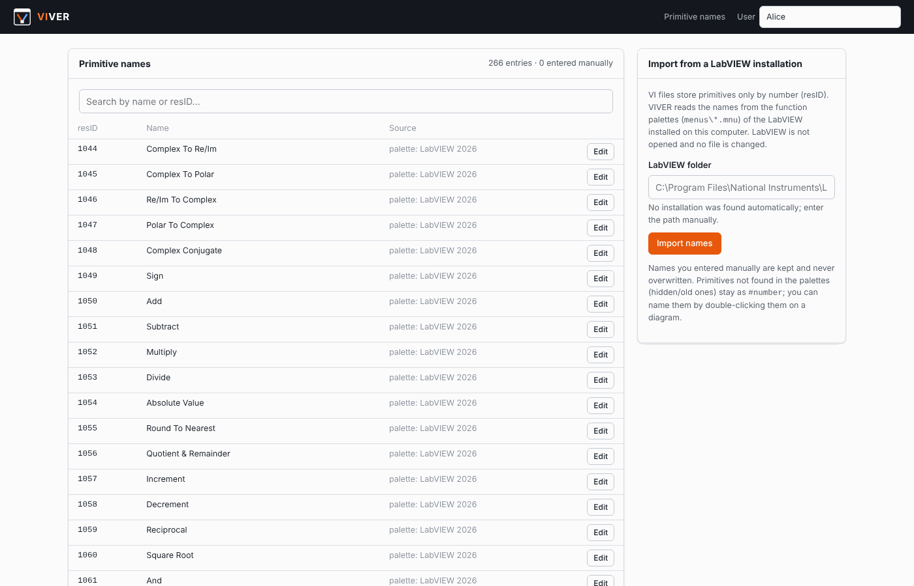</p>

---

## Command line and LabVIEW integration

`tools/viver_commit.py` talks to a running VIVER server and uses only the Python standard library:

```bash
python tools/viver_commit.py --list                       # list repositories
python tools/viver_commit.py Line1 --status               # uncommitted changes
python tools/viver_commit.py Line1 -m "Before build 1.4" -a LabVIEW
python tools/viver_commit.py Line1 --changelog v1.0..main -o CHANGELOG.zip
```

To commit automatically before every build, call the command with **System Exec.vi** from the pre-build VI of your build specification. JSON endpoints (`/api/r/<repo>/status`, `/api/r/<repo>/commit`, `/api/r/<repo>/changelog`) are available for other tools.

---

## Configuration

Environment variables:

| Variable | Default | Description |
|---|---|---|
| `VIVER_DATA` | `./data` | Database, backup objects, cache, CHANGELOGs |
| `VIVER_HOST` | `127.0.0.1` | Use `0.0.0.0` to make VIVER reachable from your network |
| `VIVER_PORT` | `5000` | Port |
| `VIVER_PASSWORD` | — | If set, every page asks for this password (HTTP Basic) |
| `VIVER_URL` | `http://127.0.0.1:5000` | Server address used by the command line tool |

When sharing VIVER with a team over the network, always set `VIVER_PASSWORD` together with `VIVER_HOST=0.0.0.0`. The *project folder* feature reads folders on the machine VIVER runs on; colleagues on other computers can upload from the browser or use a shared network folder.

**Ignored files:** `.lvlps`, `.aliases`, `builds/`, `.git/` and temporary files by default. Add your own rules in the repository settings or in a `.viverignore` file in the project folder (one rule per line, e.g. `*.log`, `data/`).

**Where is everything stored?**

```
data/
  viver.db           repositories, commits, branches, tags (SQLite)
  objects/ab/cd…     compressed file contents — every version of every file
  cache/             parsed VI models and diff results (safe to delete)
  changelogs/        generated CHANGELOGs
  commit-zips/       per-commit project ZIPs (if enabled and no other folder is set)
  restore-backups/   ZIP of the project folder taken before each in-place restore
  snapshot-tmp/      short-lived snapshot copies while reading the project folder
```

Backing up the `data/` folder backs up the entire history.

---

## FAQ

**Do I need LabVIEW to compare VIs?**
No. VIVER parses VI files itself (through pylabview). LabVIEW is only used, if present, as the source of primitive names.

**Does VIVER need internet access?**
Only for the first `pip install`. The application makes no network connections; it serves pages to your own browser on `127.0.0.1`. All scripts, styles and fonts are local.

**Can VIVER damage my VIs?**
It opens project files read-only. Writing happens only when you explicitly restore a version, and every written file is checksum-verified with a backup of the previous state taken first. With *Never write to the project folder* enabled, VIVER does not write there at all.

**How much disk space does it use?**
Each distinct file content is stored once, compressed. Committing a 500-VI project where 3 VIs changed adds only those 3 files.

**How is this different from using Git?**
VIVER is not a replacement for Git in large teams with merge workflows — it has no merge. It is aimed at LabVIEW developers and small teams who want simple commits, real backups and *readable* VI diffs and changelogs without extra tooling. You can still keep the project in Git as well; VIVER stores its own history in `data/`.

**Which LabVIEW versions are supported?**
pylabview is best tested with files from LabVIEW 2014–2020; files from newer versions (2020/2021 in our tests) generally work, but some blocks may stay undecoded. VIs that cannot be parsed are still versioned and backed up, and are reported as *unreadable*.

---

## Known limitations

- **Wire routes are simplified.** Connections are correct, but wires are redrawn with right angles rather than the exact bends from LabVIEW.
- **Cluster constants** are reported as "value changed" without showing their contents; enums, strings, numbers, booleans, paths and simple arrays show old → new values.
- **SubVIs are drawn as named boxes**, not with their icons (the VI's own icon is shown in the header).
- **Compiled code:** if *Separate compiled code from source file* is off, LabVIEW changes the file on every save; such VIs appear as changed but are classified as *re-saved only*. Keeping that option on is recommended.
- **Password-protected block diagrams** have not been tested.
- **No merge.** Branches are meant for experiments and rollback points.

---

## Project structure

```
app.py                    Flask application (pages + JSON API)
viver/storage.py          content-addressed store, commits, branches, snapshots, restore, export, ZIP, verify
viver/vi_parser.py        builds the block diagram model from the pylabview output
viver/vi_diff.py          matches two VI models, extracts and classifies the differences
viver/service.py          model / diff cache
viver/changelog.py        CHANGELOG.md generation
viver/svgrender.py        previous + new block diagram in one SVG (CHANGELOG images)
viver/render.py           shared drawing code used by svgrender
viver/palettes.py         primitive names from the LabVIEW palettes
viver/mdlite.py           small Markdown renderer for the CHANGELOG preview
static/diagram.js         SVG block diagram renderer (browser)
static/vidiff.js          diff and viewer pages
templates/                HTML pages
tools/viver_commit.py     command line client
third_party/pylabview     VI parser (MIT)
docs/                     screenshots and an example CHANGELOG
```

---

## License, trademarks and credits

VIVER is released under the [MIT License](LICENSE). It bundles [pylabview](https://github.com/mefistotelis/pylabview) by Jessica Creighton and Mefistotelis (MIT). See [THIRD_PARTY_NOTICES.md](THIRD_PARTY_NOTICES.md) for all third-party licenses.

VIVER is an independent project and is not affiliated with, endorsed by, or sponsored by National Instruments (NI) or Emerson. LabVIEW and NI are trademarks of National Instruments Corporation. Other product names are used only to describe compatibility.

**Built with the assistance of Claude.** VIVER was designed and developed with the assistance of Claude.

The screenshots and the example CHANGELOG show VIs from the open-source LabVIEW Icon Editor, JKI State Machine and OpenG projects, used for illustration only; they remain the property of their respective authors and are covered by their own licenses.
