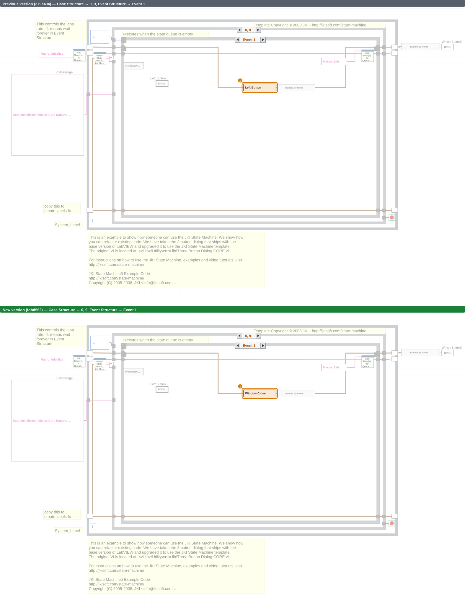
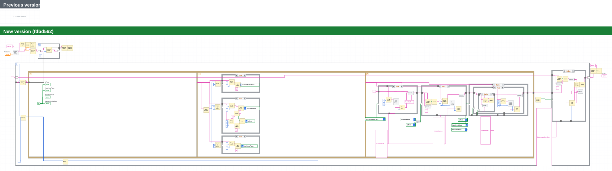

# Changelog — IconEditor

**Range:** `379e404` Add three-button dialog (2026-10-09 16:02) → `fdbd562` Adjust string length constants in the sequence (2026-10-11 19:02)  
**Branch:** `main` · **Generated:** 2026-10-12 22:10 · VIVER  
**Scope:** Block diagram logic, Front panel  

## Summary

| | Count |
|---|---:|
| VIs with content changes | 2 |
| VIs with visual/layout changes only | 0 |
| Other file changes | 0 |

### Changed VIs

| VI | Status | What changed |
|---|---|---|
| [Three Button Dialog.vi](#vi-dialog__three_button_dialog) `Dialog` | 🟧 Modified | **Block diagram** 🟧1: Constant “Which Button?” modified (value "Left Button" → "Window Close") |
| [Number to Proper Engl Text.vi](#vi-openg__number_to_proper_engl_text) `OpenG` | 🟩 New | New VI added (17 top-level items on the block diagram) |

_Details and images are below; click a VI name to jump to its section._

## Commits

- `fdbd562` 2026-10-11 19:02 — **Adjust string length constants in the sequence** _(Bob)_
- `a478ee5` 2026-10-11 01:02 — **Add OpenG number-to-text example** _(Alice)_
- `330d321` 2026-10-10 07:02 — **Dialog: react to window close instead of the left button** _(Bob)_

## VIs with content changes

Changed items are marked with numbered boxes in the images: 🟩 added, 🟥 removed, 🟧 modified, 🟪 only moved into another structure/frame. Unchanged parts are dimmed. The numbers match the lists below.

### Three Button Dialog.vi

`Dialog/Three Button Dialog.vi` · Modified

**Block diagram changes**

1. 🟧 Constant “Which Button?” modified — value "Left Button" → "Window Close" _(While Loop › Case Structure [0, 9] › Event Structure [Event 1])_

**Block diagram — previous and new version**

_View 1 — Case Structure → 0, 9, Event Structure → Event 1 · change 1_

_The image is an SVG: click to open it full size; it stays sharp when you zoom in the browser._

---

### Number to Proper Engl Text.vi

`OpenG/Number to Proper Engl Text.vi` · New VI

- **New file**

**Block diagram — previous and new version**

_The image is an SVG: click to open it full size; it stays sharp when you zoom in the browser._

---
